# Graph: Mermaid template, plan.json, and node splits

## Mermaid template

The example is a data migration. Keep the shapes and replace the phases with your own.

Rectangle = `task`, `[/ /]` = `ops`, `{{ }}` = merge point or ship point, `{ }` = `decision`, subgraph = phase. An arrow `A --> B` means B starts after A.

```mermaid
flowchart LR
  subgraph P1[Phase 1: expand · target main]
    S[schema: add Y tables] --> DW[dual-write]
    DW --> MP1{{MERGE POINT 1}}
    MP1 --> DEP1[/ops: deploy/]
    DEP1 --> SH1{{SHIP POINT 1}}
  end
  subgraph P2[Phase 2: migrate · target main]
    SH1 --> BF[backfill job]
    SH1 --> R[read from Y behind flag]
    BF --> MP2{{MERGE POINT 2}}
    R --> MP2
    MP2 --> DEP2[/ops: deploy/]
    DEP2 --> RUN[/ops: run backfill/]
    RUN --> PAR[/ops: verify parity in prod/]
    PAR --> D{decision: cut over?}
    D --> FLIP[/ops: flip read flag/]
    FLIP --> SH2{{SHIP POINT 2 · soak 24h}}
  end
  subgraph P3[Phase 3: contract · after the release]
    SH2 --> RM[remove X writes]
    RM --> DROP[drop X tables]
    DROP --> MP3{{MERGE POINT 3}}
    MP3 --> DEP3[/ops: deploy/]
    DEP3 --> SH3{{SHIP POINT 3}}
  end
```



What the example shows:

- Lane `write` (schema → dual-write) is one stack: dual-write stacks on the unmerged schema branch. Dual-write can start when schema is code done; the wave review of schema runs at the same time.
- The backfill job needs the schema, but it is in another lane. The edge goes through ship point 1, so the job starts from the updated target. The backfill also needs dual-write live in prod, which ship point 1 confirms.
- The soak is not a node. The coordinator records its deadline when the human confirms the flag flip.

## plan.json

`wg check`, `wg load`, and `wg ready` read this file. Phase 1 and the start of phase 2 of the template; this excerpt does not pass `wg check` until phase 2 has its merge point and ship point:

```json
{
  "effort": {"name": "Migrate X to Y", "slug": "xy", "team": "APP", "initiative": "Platform migrations", "summary": "One line, at most 255 characters"},
  "phases": [
    {"key": "1", "name": "Phase 1: expand", "target": "main", "ship_env": "beta"},
    {"key": "2", "name": "Phase 2: migrate", "target": "main", "ship_env": "beta", "soak": "24h"}
  ],
  "nodes": [
    {"key": "schema", "kind": "task", "phase": "1", "lane": "write", "title": "Add Y tables (additive)",
     "acceptance": "Y tables exist; X is untouched.",
     "owns": ["web/node-backend/src/y/**"], "shares": ["pnpm-lock.yaml"]},
    {"key": "dualwrite", "kind": "task", "phase": "1", "lane": "write", "title": "Dual-write X and Y",
     "owns": ["web/node-backend/src/x/write/**"]},
    {"key": "mp1", "kind": "merge-point", "phase": "1", "title": "MERGE POINT 1: phase 1 merged to main"},
    {"key": "deploy1", "kind": "ops", "phase": "1", "title": "Deploy phase 1 to beta"},
    {"key": "ship1", "kind": "ship-point", "phase": "1", "title": "SHIP POINT 1: dual-write live"},
    {"key": "backfill", "kind": "task", "phase": "2", "lane": "data", "title": "Backfill job Y from X",
     "eng": "ENG-8800"}
  ],
  "edges": [
    {"from": "dualwrite", "to": "schema"},
    {"from": "mp1", "to": "schema"},
    {"from": "mp1", "to": "dualwrite"},
    {"from": "deploy1", "to": "mp1"},
    {"from": "ship1", "to": "deploy1"},
    {"from": "backfill", "to": "ship1"}
  ]
}
```

Fields:

- **Edge direction:** `from` depends on `to`. `to` finishes first. In Linear, `to` blocks `from`.
- Effort fields: `name` (the Linear project), `slug` (`wg dispatch` builds the worktree and branch names from it), `team`, `summary`. `workspace` is the id of a configured workspace (setup.md "Linear workspace"; default: the first one); it contains no key. `team` defaults to that workspace's `team`. Optional `initiative`: the name of the initiative that groups this project with related efforts ("Initiatives" below). Optional `test`: the test command of the effort as a list of arguments. It replaces both default runs of `wg evidence` (terms.md, evidence): the affected test tasks of a node, and the repo-wide suite of a phase, from the config `test_runner`. Without a `test_runner`, each plan needs `test`. Optional `lint`: the lint command of push check step 4 (worker-spec.md) as a list of arguments; each `{lower}` is the node's diff base. It replaces the config `test_runner.lint`, which applies only to a plan with no `test`. With no lint command, or `[]`, the worker spec has no lint step. Optional `rules`: a text of rules for each worker of the repository, for example the test commands or the checkouts not to edit. `wg dispatch` adds it to each dispatch spec as `## Repository rules`, so an issue description does not repeat it. `wg check` rejects a `lint` that is not a list of strings and a `rules` that is not a text.
- Node fields: `key`, `kind` (`task`, `spike`, `decision`, `ops`, `merge-point`, `ship-point`), `phase`, `title`. A `task` also needs `lane`, except the integration task. Optional: `role` (`hotfix`, `sync`, `integration`), `acceptance`, `owns`, `shares`, `description`, `priority` (1–4), `eng`, `issue`, `by` (`ops` only: `human`, the default, or `coordinator`, for a step the repository lets the agent do; with `human`, `wg next` prints the node as `do ask`, and the page shows the human as the one who must act), and `branch` and `pr` for existing work (jobs.md "Adopt an existing branch or PR").
- `eng` (`^[A-Z]+-[0-9]+$`): the node is that existing ENG ticket. `wg load` maps it in `keymap.json`, gives it relations, and keeps its node card comment. `wg move` writes its status (setup.md "ENG tickets"). `wg` never changes its title or description, and never copies it.
- `issue` (`^[A-Z]+-[0-9]+$`), to map an existing issue of the plan's team: the node is an issue that exists already, for example an adopted `Triage` issue. `wg load` maps it and creates no issue; with `--apply` it moves the issue into the effort's project (`update <key>: project`). In every other way it is a plan-team node. Its description is never rewritten. A node has `eng` or `issue`, never both.
- Edges follow ordering.md "Constraint → encoding". `wg check` rejects:
  - a cycle, a duplicate edge, a node the ship point does not reach, a cross-lane edge inside a phase, and a task that is not before its anchor (the merge point for a pre-merge task, the ship point for a post-merge task);
  - a phase with no `target`;
  - in each phase after the first, a `task`, `ops`, merge point, or ship point that does not reach the previous phase's ship point (`decision` and `spike` are exempt);
  - an `ops` node, a post-merge task, or a ship point that does not reach its phase's merge point;
  - in a `<release>` phase: a pre-merge task without role `hotfix`, a pre-merge task that depends on another task, or not exactly one `sync` task;
  - in other phases: role `hotfix` or `sync`, and role `integration` unless the target starts with `effort/` (then exactly one `integration` task).

## Release phase plan.json

A `<release>` phase: the HOTFIX is the only pre-merge task. Deploy and SYNC both start after the merge point. The SYNC task is post-merge, so the ship point depends on it.

```json
{
  "effort": {"name": "Fix Z in prod", "slug": "z", "team": "APP"},
  "phases": [{"key": "1", "name": "Phase 1: hotfix", "target": "<release>", "ship_env": "prod"}],
  "nodes": [
    {"key": "fix", "kind": "task", "phase": "1", "lane": "fix", "role": "hotfix", "title": "HOTFIX: stop Z"},
    {"key": "mp1", "kind": "merge-point", "phase": "1", "title": "MERGE POINT 1: HOTFIX merged to <release>"},
    {"key": "deploy1", "kind": "ops", "phase": "1", "title": "Deploy <release> to prod"},
    {"key": "verify1", "kind": "ops", "phase": "1", "title": "Verify Z stopped in prod"},
    {"key": "sync1", "kind": "task", "phase": "1", "lane": "sync", "role": "sync", "title": "SYNC: <release> to main"},
    {"key": "ship1", "kind": "ship-point", "phase": "1", "title": "SHIP POINT 1: fix live, synced to main"}
  ],
  "edges": [
    {"from": "mp1", "to": "fix"},
    {"from": "deploy1", "to": "mp1"},
    {"from": "verify1", "to": "deploy1"},
    {"from": "sync1", "to": "mp1"},
    {"from": "ship1", "to": "verify1"},
    {"from": "ship1", "to": "sync1"}
  ]
}
```

## Split a node

A node too big for one PR becomes sibling nodes in the same phase and lane.

1. In `plan.json`, add the new nodes with the old node's `phase`, `lane`, and `role`. Chain them in the lane.
2. Move the old node's edges: the first new node depends on what the old node depended on. Each node that depended on the old node depends on the last new node. The anchor depends on each new node.
3. `wg move <plan-dir> <old key> Canceled` with a comment `split into <new identifiers>`. Then remove the old node from `plan.json`. `wg check` must exit 0.
4. `wg load <plan-dir>` (dry run: it prints `orphan <old key> -> <identifier>`), then `wg load <plan-dir> --apply --prune`. `--prune` deletes blocks relations between mapped graph issues that `plan.json` does not have, then removes the orphan's node entry and run row. It leaves the issue itself and relations to issues outside the graph in place.
5. Update the flowchart in `PLAN.md`.

Done when: `wg check` exits 0 and `wg load <plan-dir>` reports no `missing`, no `not in plan.json` relation, and no `orphan`.

## Initiatives

An initiative groups related projects, for example each effort on one tool. It is a child label of the project label group `initiative`, not a Linear initiative: those are company-wide. In a workspace with `team_labels: true` the group belongs to the plan's team, so only that team sees it. Else it is a workspace group, because Linear's team project labels need the Business plan. The group is single-select, so a project has at most one initiative.

- In step 1, set `effort.initiative` in `plan.json`. Use the name of an existing initiative when the effort continues its work: When the name is new, `wg load` prints `create initiative <name> (existing: <names>)`. Make a new name only for a new area of work. Do not ask the human to approve the name.
- `wg load --apply` creates the group and the initiative label when they are missing, and sets the label on the project. It replaces another initiative label on the project. Without `effort.initiative`, `wg load` leaves the project's labels as they are.
- The page groups the overview by initiative (page.md "Data and links"). `?initiative=<URL-encoded name>` opens the overview with only that initiative.
